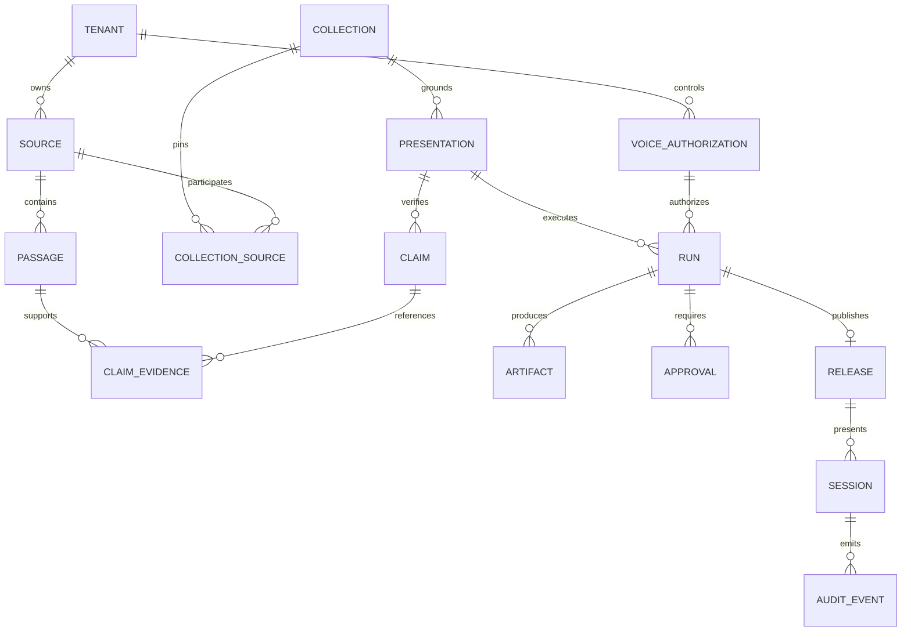

# Software design and implementation guide

**Status:** Full-product implementation specification. A smaller local
source-to-PPTX increment now exists; see its
[actual scope and setup](local-development.md). The full services, contracts,
and production controls below are not all implemented. Read the
[architecture](presentation-architecture.md) and
[acceptance strategy](validation-and-delivery.md) together with this guide.

## 1. Repository and service boundaries

Extend the README's Python direction rather than introducing a competing backend.
Use an initial modular monolith API with separate durable and rendering workers:

```text
apps/web/                    React/TypeScript owner, moderator and audience UI
app/api/                     FastAPI routes, OIDC, RBAC, request validation
app/domain/                  Authorization, deck, evidence and release models
app/workflows/               Temporal workflows and cancellation handling
app/activities/              Ingestion, claims, narration and release activities
app/providers/               OpenAI, ElevenLabs and storage adapters
app/knowledge/               Parsing, hybrid retrieval and index publishing
workers/render/              PptxGenJS, React slide components and Remotion
contracts/                   Versioned JSON Schemas and generated TS types
evals/                       Synthetic/authorized cases and scoring rubrics
tests/                       Unit, contract, integration and E2E tests
infra/                       Reviewed deployment and environment configuration
```

This is the target layout, not a list of existing files. Start with one workflow
and explicit activities, not a framework for arbitrary agents. The backend owns
the contracts; export JSON Schema/OpenAPI from Pydantic and generate frontend
types. Validate all model/provider outputs again at the service boundary.

## 2. Canonical contracts and invariants

Use JSON Schema with `additionalProperties: false`, bounded strings/arrays, enums,
and version tags. Store source excerpts with restricted access; expose only
approved display citations. Required logical contracts:

| Contract | Required fields and invariant |
|---|---|
| `PresentationBrief` | Owner/tenant, audience, language, target duration, slide bounds, output formats, collection version, theme version, cost ceiling, publication policy ID |
| `SourceRecord` | Source ID, immutable content hash, revision, rights reference, approval status, title, source locator, retrieved/published/as-of dates, expiry/review-by date |
| `EvidencePassage` | Chunk ID, source hash, page/section/table locator, exact text span, index version, tenant and access labels |
| `Claim` | Claim ID, statement, source passage IDs, numeric values/units, applicable date, verification status, reviewer record; distinguish fact, opinion and decorative content |
| `DeckSpec` | Schema version, brief hash, ordered slides, claim ledger reference, theme version, approved script hash and evidence collection version |
| `SlideSpec` | Stable ID, layout enum, title, typed text/chart/media blocks, claim IDs, speaker notes, narration, alt text and source footer |
| `VoiceAuthorization` | Owner, private provider voice ID, verification reference, permitted uses/languages/destinations, validity interval, consent version, revocation epoch |
| `Timeline` | Ordered slide IDs, measured audio durations, start/end timestamps, cue timings, transition durations, sample rate and frame rate |
| `ArtifactManifest` | Release/run IDs, immutable artifact hashes, app/model/prompt/config/index versions, approvals, authorization version, QA report and signing-key ID |

Invariants belong in deterministic application validators, not just prompts:

- Every factual slide block and factual narration sentence references verified
  claims. Source IDs must exist in the exact pinned collection and belong to the
  same tenant. A citation existing does not prove it supports the claim.
- Narration cannot introduce additional unreviewed facts or numbers. Numbers,
  dates, currencies, units, chart series and totals must match source data.
- A source conflict or expired fact produces `needs_review`, never an invented
  compromise. A low model confidence score cannot substitute for evidence.
- Generated charts use typed numeric datasets and deterministic rendering.
  Illustrations are labeled and must not imply real documentary evidence.
- Theme tokens bound font sizes, contrast, safe areas and text length. Long text
  triggers a split/rewrite and renewed validation, not unreadable shrinking.
- Only a server-resolved authorized voice ID reaches synthesis. Clients cannot
  select arbitrary provider IDs or supply an approval flag.
- Publication requires exact content hashes to match the approved release.
  Changing text, sources, voice, theme or applicable policy invalidates approval.

### Minimal model-facing slide shape

Illustrative fragment; the complete schema must include the contracts above:

```json
{
  "schema_version": "1",
  "slide_id": "s1",
  "layout": "title_and_bullets",
  "title": "Project objective",
  "blocks": [
    {
      "type": "text",
      "text": "Deliver approved material in an authorized synthetic voice.",
      "claim_ids": ["claim-001"]
    }
  ],
  "narration": {
    "text": "Our objective is to deliver approved material in an authorized synthetic voice.",
    "claim_ids": ["claim-001"]
  },
  "source_footer": ["source-001:section-objective"]
}
```

Model output must not contain executable JavaScript, Python, HTML, shell commands
or unrestricted URLs. Tool calls use explicit allowlisted server functions.
Strict structured output is preferred where supported; even then validate schema,
references, length and refusal/incomplete status before persisting a candidate.

## 3. API and event design

All mutation routes require authentication, tenant authorization, bounded payloads,
audit events, and idempotency keys. Owner/moderator-only actions require an
appropriate role; voice enrollment/revocation and release approval require
step-up authentication. Audience tokens are short-lived and session-scoped.

| Proposed route | Behavior |
|---|---|
| `POST /v1/sources` | Create quarantined upload; server generates storage key and validates actual media type |
| `POST /v1/collections/{id}/publish` | Publish reviewed immutable index version after evaluation |
| `POST /v1/voice-authorizations` | Start owner enrollment; return pending state, never assume verification succeeded |
| `POST /v1/voice-authorizations/{id}/revoke` | Revoke, increment epoch, stop affected work and track provider deletion |
| `POST /v1/presentations` | Validate brief; return `202`, run ID and status URL; same idempotency key/payload returns same run |
| `GET /v1/presentations/{id}` | Return state, stage, blocking reasons, cost and progress; no fabricated percentage |
| `POST /v1/presentations/{id}/approve` | Approve exact content/config hashes with expected state/version |
| `POST /v1/presentations/{id}/cancel` | Cancel workflow, provider work and artifact delivery where possible |
| `GET /v1/releases/{id}/artifacts` | Authorize against current policy/epoch; return short-lived artifact access |
| `POST /v1/sessions` | Start presentation/Q&A from an authorized published release |
| `POST /v1/sessions/{id}/stop` | Owner/moderator emergency stop, independent of provider availability |
| `WS /v1/sessions/{id}/events` | Authenticated bounded text/audio events, captions, interrupts, source references and explicit errors |

For browsers, avoid long-lived tokens in query strings; authenticate the socket
with a secure same-site session or a short-lived single-use ticket. Enforce origin
checks and CSRF protection as applicable. Never place provider secrets in web code.

Event envelope: `event_id`, `schema_version`, `run_id/session_id`, `turn_id`,
`sequence`, `timestamp`, `type`, and a typed payload. Persist authorization/state
changes transactionally with an outbox; consumers deduplicate by `event_id`.
Reject stale turn audio after cancellation. Reconnection retrieves current state
and events after a sequence cursor; do not replay old speech automatically.

Use a structured error body with stable `code`, safe `message`, `request_id`,
`stage`, and `retryable`. Return 403 for denied access, 409 for conflicting state
or idempotency payloads, 422 for invalid contracts, 429 for quotas, and explicit
provider/timeout failures. Log redacted diagnostics server-side; never include
source text, voice samples or provider keys in exception messages.

## 4. Persistence and provenance design



Include tenant IDs and authorization filters on every metadata/index query.
Enforce matching tenant IDs with database constraints or composite keys, not just
API convention. Use database row-level security as defense in depth. Soft deletion
alone is insufficient for a deletion request: trace derived embeddings, audio,
cached outputs, provider copies and backups under the documented retention policy.

Keep object keys immutable and content-addressed where appropriate. Store hashes,
not public URLs, as artifact identities. Encrypt enrollment separately with tightly
restricted access; application workers should normally need only its private
provider voice ID and current authorization, not original recordings.

Sign the release manifest using a managed signing key. Verification establishes
issuer and file integrity, not truth, legal ownership or a guarantee against
cloning. Keep key rotation and public verification instructions documented.

## 5. Coding the durable pipeline

Implement steps in this order:

1. `validate_brief`: authenticate; check limits, source version, policy, voice
   status and provider configuration. Fail before expensive work.
2. `retrieve_evidence`: hybrid full-text/vector retrieval scoped to the pinned
   collection; preserve exact source locators. Rerank only if measured retrieval
   gaps justify the extra dependency/cost.
3. `plan_and_verify`: create outline and claim ledger; validate citations, numbers,
   dates and contradiction handling before expanding to slides.
4. `build_deck`: generate validated DeckSpec and deterministic previews; verify
   overflow/accessibility and store an immutable approval candidate.
5. `approve`: wait durably for an authorized human or evaluate the recorded
   low-risk auto-publication policy. Record exact approved hashes.
6. `synthesize`: check consent and budget; split by approved sentences/slides;
   apply a versioned pronunciation dictionary; synthesize and measure each audio
   asset. A pronunciation edit affecting wording requires reapproval.
7. `align_and_render`: compute timeline from decoded audio duration, not token
   count or estimated speaking speed. Generate captions, MP4 and PPTX.
8. `validate_release`: verify every artifact, provenance link and active
   authorization. Sign and atomically publish a manifest pointing to immutable
   objects; do not expose partial bundles.

Temporal workflow code must remain deterministic; use activities for provider
calls, clocks, randomness, storage and rendering. Activity retries do not imply
exactly-once vendor billing. Keep an attempt ledger; use provider idempotency
where supported. If a timeout leaves vendor completion unknown, reconcile it or
request an explicit retry decision instead of blindly creating duplicate paid jobs.

Recommended initial operational settings, to tune in staging: at most two content
repair attempts; three transient retries with jitter and backoff only for safe
operations; hard per-stage and per-run deadlines; bounded concurrency per tenant
and provider. Honor `Retry-After`, circuit-break failing providers, and propagate
cancellation. Budget exhaustion pauses with an explicit reason, never hides cost.

Caching keys include approved text hash, resolved model, private voice ID, consent
version/epoch, language, pronunciation settings and output format. Partition
caches by tenant. Cache hits still require live authorization before delivery.
Never reuse audio from revoked/expired consent. Do not cache audience questions
or raw audio by default.

## 6. UI, accessibility and degraded operation

The owner UI must show source approval status, claim-level citations, conflicts,
preview slides, script, pronunciation controls, forecast cost, approval history,
job state, cancellation and retention settings. The audience UI shows clear AI
voice disclosure, keyboard-accessible controls, captions, references, a text input
alternative and mic-consent/recording indicators.

Support screen readers, semantic reading order, visible focus, sufficient contrast
and language tags. PPTX needs meaningful titles and image alt text; verify reading
order in the actual player. Captions need speaker labels where relevant. Do not
imply that rendering a PDF or PPTX automatically produces an accessible document.

Explicit degraded modes:

| Failure | Required user-visible behavior |
|---|---|
| TTS unavailable or authorization revoked | Stop synthetic speech; display approved text and status; never switch secretly to a different voice |
| STT uncertain/unavailable | Ask audience to confirm transcript or type; do not answer an unreliable transcript |
| Evidence insufficient/conflicting | Show limitation and moderator handoff, not a plausible answer |
| Image generation fails | Omit optional decorative image with an explicit warning; keep verified content intact |
| MP4/render validation fails | Block that release; owner may explicitly request a separately validated text/PPTX-only release |
| Live transport disconnects | Stop local audio, show disconnected status, reconcile current state before resuming |

## 7. Implementation milestones and definition of done

| Milestone | Build | Exit requirement |
|---|---|---|
| M0: decisions and rights | Approved sources, owner voice consent, provider/data-region review, cost/SLO targets | Recorded sign-off, sandbox access, preflight passes |
| M1: grounded text | Ingestion, hybrid retrieval, claims, text Q&A, evaluation harness | Evidence and refusal gates pass; cross-tenant access blocked |
| M2: presentation generation | Typed DeckSpec, PPTX/React templates, source footers, approval UI | Editable and readable test decks, correct charts/citations, approval invalidation proven |
| M3: authorized voice | Enrollment adapter, narration, timing, captions, revocation | Owner voice acceptance plus interruption, expiry and kill-switch tests pass |
| M4: automated media | Durable workflow, rendering, manifest, budget and retries | Complete bundle produced reproducibly within agreed resource/cost limits |
| M5: live audience mode | STT, session control, grounded short answers, moderator handoff | Latency, barge-in, echo/noise and safety dress rehearsal passes |
| M6: production delivery | Staging/canary, runbooks, restore/deletion, alerts and support ownership | All delivery gates pass; accountable owner accepts release |

Do not assign a reliable calendar date until team size, deployment platform,
languages, audience size, budget and avatar scope are agreed. M1-M4 deliver the
prerecorded MVP; M5 is a separately qualified interactive feature.

Hand over source and dependency locks, schemas/migrations, reviewed infrastructure,
threat/data-flow assessment, provider configuration inventory, SBOM/license
inventory, evaluation results, signed sample artifacts, API/user documentation,
moderator training, incident/rollback/restore/deletion runbooks, monitoring
dashboards and support ownership. Do not include production secrets or private
enrollment recordings in the handover repository.
