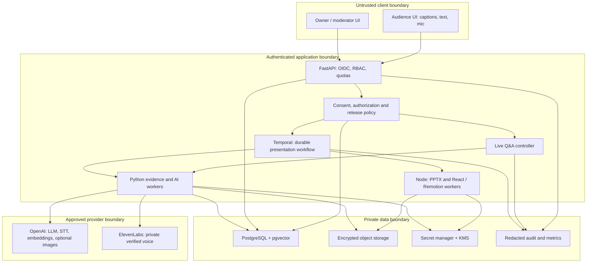
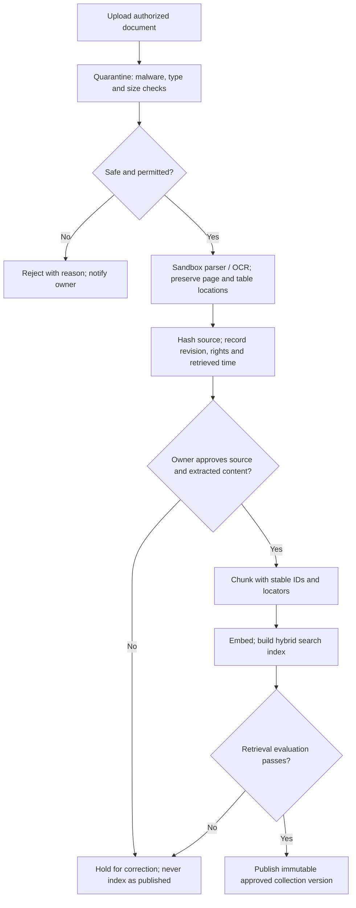
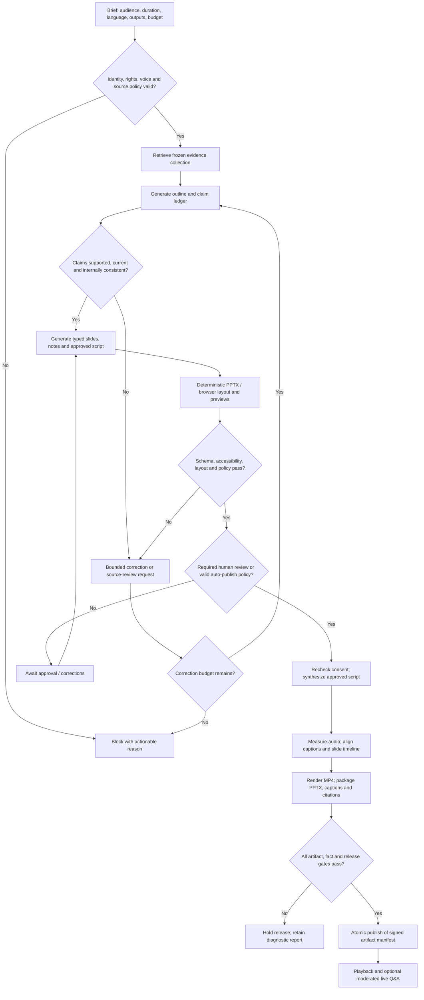
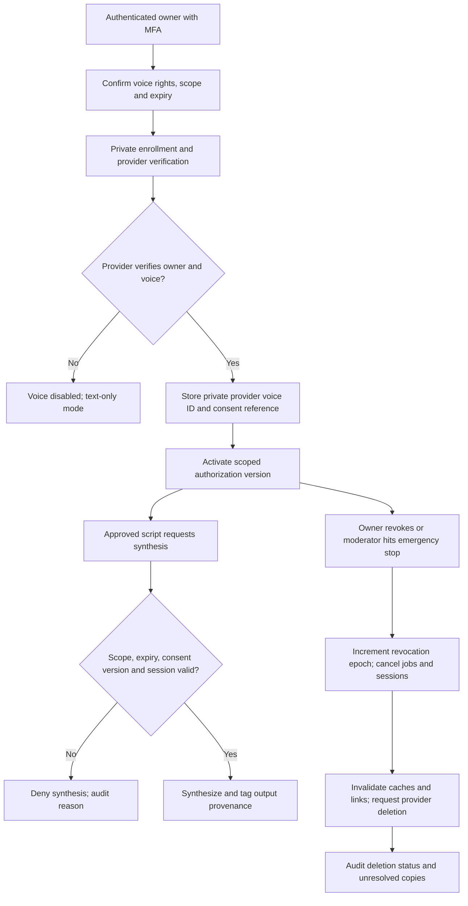
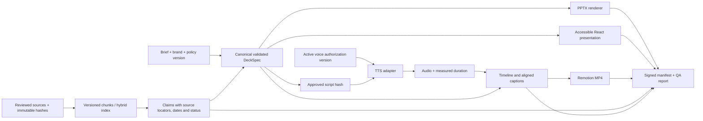
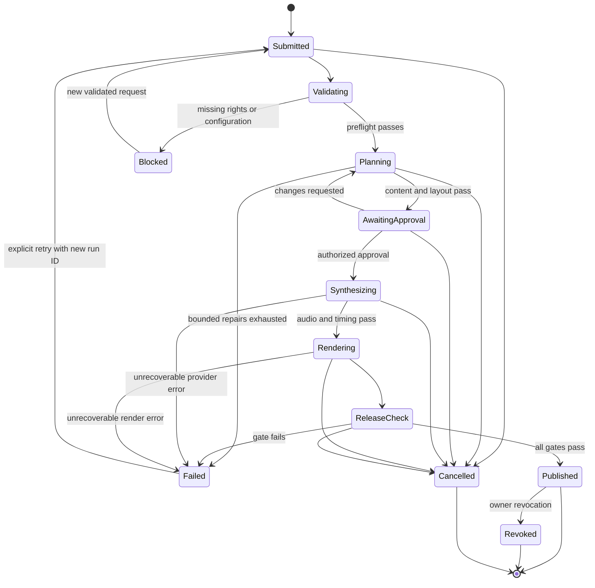
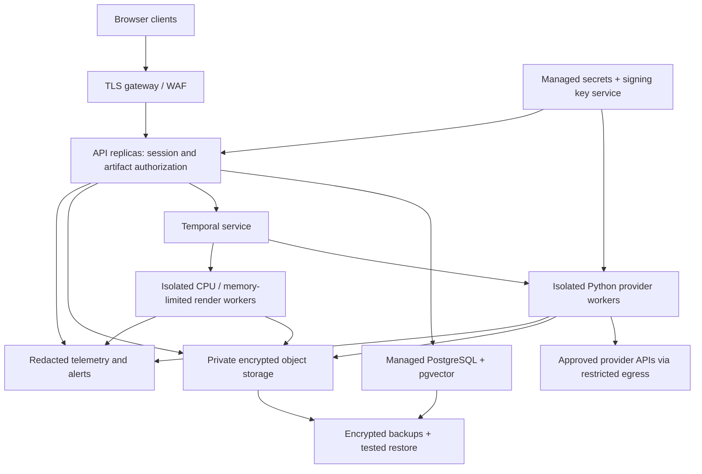
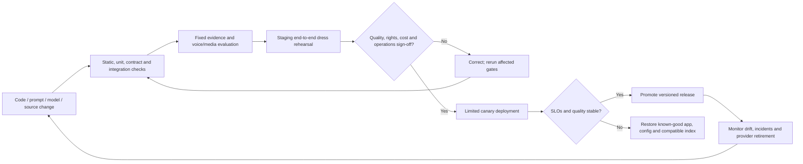

# Automated presentation architecture and model selection

## 1. Product outcome and automation boundary

Input: a topic, audience, language, target duration, brand template, approved
documents, and an authorized voice profile. Output: editable PPTX, narrated MP4,
WebVTT captions, transcript, accessible browser presentation, source bibliography,
and a signed release manifest. An optional live mode answers audience questions
from the published evidence in the same authorized voice.

This is the **full target design**, not a claim that the complete product is
implemented. A [smaller local foundation](local-development.md) now supports
reviewed sources and PPTX exports. A deployment should automate repeatable work after enrollment and
approval rather than claiming that an autonomous model can guarantee truth,
copyright clearance, or legal compliance.

Default: a moderator approves each release. An owner may later authorize automatic
publication for a named, low-risk collection, audience, and destination after
acceptance testing. That policy must expire, be revocable, and still enforce every
release gate. No policy can auto-approve new voice enrollment, disputed rights,
failed evidence checks, or an emergency stop.

## 2. Concrete model decisions

**Recommendation dated 2026-11-03:** use the following baseline, not a claim that
these are the newest or universally best models. The official SDK sources below
confirm identifiers, not entitlement, benchmark quality, price, or compatibility
with every API feature. Pin a supported snapshot where available after account
preflight and evaluation. Record the resolved model and API version for every run.

| Capability | Proposed model/tool | Reason and boundary |
|---|---|---|
| Research synthesis, outline, slide text, narration script | OpenAI `gpt-5.4` via Responses API | Primary structured content generator; evidence is supplied separately and every factual claim must resolve to reviewed sources |
| Fast grounded audience Q&A and routine classification | OpenAI `gpt-5.4-mini` | Lower-cost candidate for short answers; use only after passing the same factuality gates; escalate uncertain questions to the moderator rather than guessing |
| Semantic retrieval | OpenAI `text-embedding-3-small` with PostgreSQL/pgvector | Start with one embedding model and PostgreSQL full-text hybrid retrieval; re-embed into a new index when changing model or dimensions |
| Audience speech recognition | OpenAI `gpt-transcribe` | Current identifier in the official audio SDK; validate endpoint, streaming support, language, latency, and account access before selecting the transport |
| Owner-voice prerecorded narration | ElevenLabs `eleven_multilingual_v2` with verified private `voice_id` | Baseline long-form candidate; model ID describes synthesis, not the owner's identity; enroll and verify the owner separately |
| Owner-voice interactive replies | ElevenLabs `eleven_flash_v2_5` with the same authorized profile where supported | Latency-oriented candidate; benchmark pronunciation, language support, and quality separately from prerecorded narration |
| Optional decorative image generation | OpenAI `gpt-image-2.5-sunburst` | Optional asset generation, not evidence; charts, statistics, diagrams, and factual screenshots must be built from verified data, not generated as plausible pictures |
| Grounding and policy assessment | Deterministic citation/number checks plus a separately prompted `gpt-5.4` review | Model review is advisory and may share failure modes with generation; independent evidence and human sampling remain necessary |
| Slide construction | PptxGenJS, version pinned at implementation | Deterministic editable PPTX generation from validated content; no need to have a model write arbitrary layout code |
| Browser slides and MP4 | Shared React slide components, Remotion, FFmpeg/ffprobe | One canonical deck drives both renderers; check codec compatibility and applicable licenses before deployment |
| Captions and alignment | Provider timing metadata where available; forced alignment of approved script otherwise | Do not let a second transcription silently rewrite approved wording; inspect uncertain alignment |
| Avatar, optional post-MVP | Provider adapter selected by a later consent/latency evaluation | Do not select or promise HeyGen/Tavus integration without confirming current API access, likeness consent, audio input, and streaming behavior |

An avatar is not required for a useful product. Do not add a direct speech-to-speech
model to the MVP: it could bypass the approved text and use a voice different from
the owner's. The auditable path is **STT -> grounded approved text -> authorized
TTS**. A future real-time model needs equivalent grounding, interruption, disclosure,
and voice-identity controls before use.

The official OpenAI audio SDK marks older `gpt-4o-transcribe` variants and
`whisper-1` as deprecated with an announced 2027-02-26 shutdown. Its image SDK says
`gpt-image-1` shut down on 2026-10-23. Do not copy those older example identifiers
into a new deployment; recheck deprecations at release time.

### Provider preflight and model-change gate

1. List models/voices available to the production account; check region, plan,
   quotas, voice verification, applicable terms, data use, retention, and deletion.
2. Make a minimal paid smoke request for each selected endpoint using synthetic
   content and, for synthesis, an authorized test voice. Exercise structured
   responses, citations, language, streaming, and audio format as actually needed.
3. Reject unsupported JSON fields, refused/truncated responses, missing citations,
   unavailable voice IDs, and invalid media. Log explicit configuration errors;
   never silently substitute a different model, voice, or API.
4. Run the fixed evaluation set and a representative presentation. Compare quality,
   latency, cost, and voice identity against the previous approved configuration.
5. Promote a versioned configuration only after the release gate passes. Track
   retirement dates; a provider alias change requires requalification, not trust.

Actual vendor price and an affordable per-presentation ceiling must be agreed
before launch. Meter input/output tokens, embeddings, image requests, synthesized
characters/audio, render minutes, storage, and egress. Forecast the next step
against the remaining job budget and reserve cost atomically before dispatch.

## 3. Application/tool combination

Keep the README's Python service direction: FastAPI/Pydantic for the API,
Temporal's Python SDK for durable workflows, and provider SDKs behind adapters.
Use Node.js/TypeScript workers for PptxGenJS and React/Remotion. PostgreSQL stores
metadata, authorization, workflow references, and pgvector indexes; private
S3-compatible storage contains documents and media. OIDC authenticates owners and
moderators. OpenTelemetry captures redacted operational traces.

Temporal is the proposed durable scheduler, not an LLM agent framework. Avoid
adding LangChain, a second job queue, multiple vector databases, or an autonomous
agent swarm until a measured requirement justifies them. Models propose content;
application code owns permissions, state, timing, budgets, and publication.

### Component and trust-boundary diagram



Only the minimum approved content crosses a provider boundary. Never send
enrollment recordings to an unrelated image, analytics, or evaluation service.

## 4. Evidence ingestion activity



Web research is an optional input adapter, not an unrestricted browser agent.
Use allowlisted primary domains and an approved search API/tool where available.
Preserve search citation annotations if the selected API provides them, but fetch
and review the underlying evidence separately. A search snippet is not proof.
Apply SSRF protection, redirect revalidation, private-network blocking, size/time
limits, and a sandboxed parser to fetched URLs. Retrieved text is untrusted data,
never a source of instructions or permission to call tools.

## 5. End-to-end generation activity



Set at most two automated content-repair attempts per stage initially. Layout
repair may change layout only; text changes invalidate downstream claim checks,
approval, audio, captions, and renders. A failed gate does not become approval
because a retry budget expired.

## 6. Voice enrollment, authorization and revocation activity



Do not automate identity-verification challenges or publish enrollment files.
Recheck authorization before provider calls, between streamed chunks, before
delivery of cached audio, and at publication. Revocation cannot retract downloads
already made. Existing README voice-protection and legal limitations still apply.

## 7. Data-flow and artifact lineage



Use the DeckSpec as the canonical semantic source; never parse PPTX back into video
frames as the default. PPTX and React are separate renderers with shared theme
tokens and semantic content, not a promise of pixel-identical rendering. Test both.
MP4 is the dependable narrated playback deliverable; embedded PowerPoint audio
is optional and needs separate player compatibility tests.

## 8. Live Q&A sequence and interruption flow

```mermaid
sequenceDiagram
    actor A as Audience
    participant UI as Browser
    participant API as Live controller
    participant STT as STT adapter
    participant RAG as Published evidence
    participant LLM as Answer composer and guard
    participant TTS as Authorized voice adapter
    actor M as Moderator
    A->>UI: Consent to mic or type question
    UI->>API: Session token + question / audio
    API->>API: Validate access, quotas and input safety
    opt Audio input
        API->>STT: Bounded audio
        STT-->>API: Transcript with uncertainty
    end
    API->>RAG: Search pinned collection with tenant filter
    RAG-->>API: Evidence passages and source locations
    API->>LLM: Question + evidence; no autonomous tools
    LLM-->>API: Answer + claims + citations
    API->>API: Check support, policy and current consent
    alt Approved grounded answer
        API-->>UI: Approved text + source links + captions
        API->>TTS: Approved sentence + authorized voice ID
        TTS-->>UI: Audio through authenticated application relay
    else Uncertain, unsafe or unavailable
        API-->>UI: Explicit limitation and text status
        API->>M: Handoff request with permitted context
    end
    opt Barge-in or emergency stop
        A->>UI: Interrupt
        UI->>API: Cancel turn with monotonically increasing turn ID
        API->>TTS: Cancel synthesis
        API-->>UI: Stop playback; discard stale chunks
        API->>M: Stop event if emergency
    end
```

Provider audio must not bypass the application relay's authorization and turn-ID
checks; the TTS-to-UI arrow represents that relay. Pause prerecorded narration
during Q&A and resume from a recorded slide/time bookmark. Never run both speech
tracks at once. A moderator can mute audio, change slides, answer, or end a session.

## 9. Durable job state



Every active state also supports emergency cancellation, including validation.
Publish uses a transaction/CAS against the expected run state and authorization
epoch so a concurrent stop cannot release an unauthorized artifact.

## 10. Deployment and delivery flow



Start with one staging and one production environment, isolated credentials and
storage, and managed services where practical. GPU infrastructure is unnecessary
for this hosted-model baseline. Render untrusted documents/assets in isolated
workers without access to credentials or internal network services.



## 11. Official sources and verification limits

Official SDK evidence inspected on 2026-11-03:

| Evidence | Immutable source |
|---|---|
| OpenAI LLM identifiers | [ChatModel type](https://github.com/openai/openai-python/blob/1a2a3d02247f9eaf0614bae9d35c60cbddf1d460/src/openai/types/shared/chat_model.py) |
| Audio identifiers and deprecation notice | [AudioModel type](https://github.com/openai/openai-python/blob/1a2a3d02247f9eaf0614bae9d35c60cbddf1d460/src/openai/types/audio_model.py) |
| Image identifiers and retirement notice | [ImageModel type](https://github.com/openai/openai-python/blob/1a2a3d02247f9eaf0614bae9d35c60cbddf1d460/src/openai/types/image_model.py) |
| Embedding identifiers | [EmbeddingModel type](https://github.com/openai/openai-python/blob/1a2a3d02247f9eaf0614bae9d35c60cbddf1d460/src/openai/types/embedding_model.py) |
| ElevenLabs model IDs and usage | [Official SDK README](https://github.com/elevenlabs/elevenlabs-python/blob/5f3cf2e7f8e321c8628bb601d0c88e664136360a/README.md) |
| Streaming synthesis interface | [TTS client](https://github.com/elevenlabs/elevenlabs-python/blob/5f3cf2e7f8e321c8628bb601d0c88e664136360a/src/elevenlabs/text_to_speech/client.py) |
| Professional voice verification interface | [PVC verification client](https://github.com/elevenlabs/elevenlabs-python/blob/5f3cf2e7f8e321c8628bb601d0c88e664136360a/src/elevenlabs/voices/pvc/verification/client.py) |
| PowerPoint media support | [PptxGenJS media example](https://github.com/gitbrent/PptxGenJS/blob/3c9ec1b687c174952166f6a34b5e87ebf69fa469/demos/modules/demo_media.mjs) |

Implementation references to recheck: [Responses API](https://platform.openai.com/docs/api-reference/responses),
[Structured Outputs](https://platform.openai.com/docs/guides/structured-outputs),
[web search](https://platform.openai.com/docs/guides/tools-web-search),
[deprecations](https://platform.openai.com/docs/deprecations),
[ElevenLabs voice cloning](https://elevenlabs.io/docs/creative-platform/voices/voice-cloning),
[Remotion rendering](https://www.remotion.dev/docs/renderer/render-media),
and [Temporal Python](https://docs.temporal.io/develop/python).

Direct vendor documentation pages could not be fetched in this design session.
The linked SDK files were readable and provide the limited identifier/interface
evidence above. Current contractual consent requirements, account availability,
prices, regional support, and performance were **not** verified. Preflight must
resolve these before committing to a provider. No paid API benchmark or
owner-voice enrollment has been performed.
